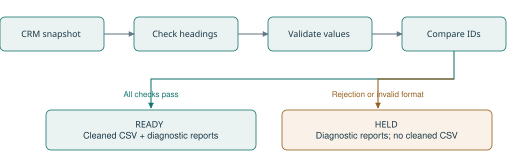
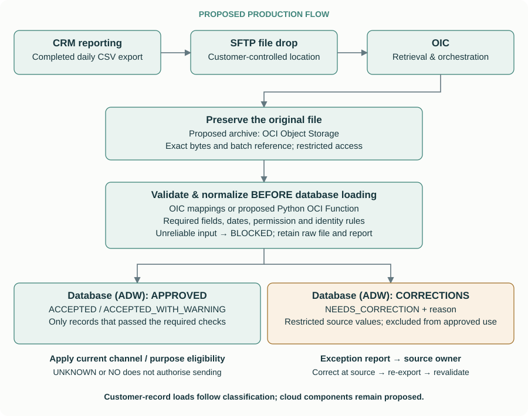

# Reliable CRM CSV ingestion

[Code and files](https://github.com/swihpi/Assesment) · [Automated validation](https://github.com/swihpi/Assesment/actions/workflows/validate.yml)

A standalone Python program preserves a received CRM CSV, normalizes approved equivalents, releases valid customer records, and reports records needing correction. If the file cannot be interpreted reliably, it blocks release of the entire input. The hypothetical customer is a sports organisation preparing customer data for analytics and later audience decisions. [Customer context and value](docs/customer_note.md) · [Assessment narrative](docs/assessment.md).

The standalone Python processor uses only Python's standard library. This is a local demonstration of the same receiving → validation → approved/correction policy proposed for ADW. The Oracle cloud integration and campaign controls are not implemented.

## Result and scope

The tested 10,000-record example preserves all input, releases 9,200 records that pass the selected rules, and reports 800 correction cases. Independent row errors permit partial release; an uncertain required mapping or malformed structure blocks the input. The destination must support partial updates: omission cannot mean deletion. All-or-nothing processing can be appropriate where complete snapshots or transactional consistency are required.

The working slice is deliberately file-to-file: changing headings, normalization, selection and diagnostics can be reproduced without cloud access. Database reconciliation and campaign eligibility remain deployment work. Passing validation does not prove every source attribute is factually correct.

## Technology key

| Service | Abbreviation | Role in this proposal |
| --- | --- | --- |
| Oracle Integration Cloud | OIC | Retrieve files and coordinate processing. |
| Autonomous Data Warehouse | ADW | Store classified customer records. |
| Oracle Analytics Cloud | OAC | Present information through dashboards. |

## Setup and run in Development or Test

Use Python 3.12 or 3.14; both are checked in clean environments. No third-party packages, credentials, database or cloud connection are required. Git is needed only for cloning; downloading and extracting the repository ZIP is an alternative.

```sh
git clone https://github.com/swihpi/Assesment.git
cd Assesment
python3 --version
```

I direct Codex to execute these checks in the local Development/Test workspace and review the results. Another engineer can reproduce them directly from the repository root:

```sh
python3 process_export.py --input samples/valid.csv --output runs/dev-valid
python3 process_export.py --input samples/renamed_report.csv --output runs/dev-renamed
python3 process_export.py --input samples/bad_values.csv --output runs/dev-exceptions
python3 -m unittest discover -s tests -v
```

The first two examples return READY and the same three normalized records. The third returns READY_WITH_EXCEPTIONS: two valid records are released, and two records need correction. Each command exits 0. Each example needs a fresh output folder; existing runs cannot be overwritten.

To demonstrate a file-level block, run this separately:

```sh
python3 process_export.py --input samples/breaking_change.csv --output runs/dev-blocked
```

This deliberately returns BLOCKED and **exit code 3**, because a required heading has no approved mapping. No cleaned CSV is produced. This is expected rejection, not a crash; chaining further commands with `&&` would stop there. Exit 1 indicates an operational/configuration failure. Invalid command syntax uses exit code 2; blocked processing uses 3. File-level blocking reasons are printed to stderr and retained in the reports.

**Never test a new script or mapping in Production first.** Use synthetic inputs locally, then validate the deployed integration in a dedicated Development/Test environment before reviewed Production promotion. [Deployment approach](docs/deployment.md).

## Processing contract

All six headings must exist, using canonical names or approved aliases:

| Field | Rule |
| --- | --- |
| `customer_id` | Required ID; preserve leading zeroes. |
| `name` | Required; tidy whitespace. |
| `region` | Required; tidy whitespace without inventing geography. |
| `member_since` | Required real date in `YYYY-MM-DD`. |
| `last_purchase_date` | Same date format or empty. |
| `marketing_permission` | Approved values become YES/NO; missing or unfamiliar values stay UNKNOWN with a warning. |

Readable CSV mappings in `config/` define heading aliases and permission equivalents. Their required headers are `source_column,output_column` and `source_value,output_value`, respectively. Empty files, header-only files, malformed rows, duplicate or empty keys and unsupported targets fail configuration validation before a run folder is created; messages identify the file and row where available. Approved heading changes and reordered columns work; an extra unused column warns. A missing/ambiguous required heading, wrong record width, broken quoting, unsupported encoding or empty input blocks the input. Even a valid prefix of a structurally broken file is not released.

For a fully parsed file, missing/invalid required values and conflicting records for the same customer ID affect those records, while valid records are released. Identical normalized duplicates are retained once. Empty CSV records are counted and rejected for missing required values; only blank physical lines are skipped. Permission mapping keys and incoming values use the same case and whitespace normalization. Names and regions use Unicode NFC normalization before comparison; customer IDs retain exact, case-sensitive matching after surrounding whitespace is trimmed. Identical invalid duplicates retain their field-level errors, and genuine ID conflicts include any field-level errors in the correction report. A new heading such as `customerdata_id` initially blocks release; only after source-owner confirmation should its alias to `customer_id` be added and tested. A change in identifier meaning or values needs identity reconciliation, not a spelling substitution.



Conflicting attributes under one ID can describe inconsistent records for the same customer. The prototype withholds the group; it does not determine whether distinct identities exist.

## Outputs, record status and completion

Every readable source is copied byte for byte to `received.csv` before parsing. The original source remains unchanged. The run folder identifies the import batch; `record` refers to a CSV data record in source order, excluding blank physical lines. Correctly shaped records containing empty fields are included. Reports also provide `source_line_start` and `source_line_end`, including for quoted multiline records. Locations remain blank when buffered decoding cannot reliably identify the failing line.

| Output | Purpose |
| --- | --- |
| `received.csv` | Exact received bytes, including records excluded from approved output. |
| `cleaned.csv` | Approved normalized records only; exists only for a releasable run. |
| `record_status.csv` | Source-record reference, available customer ID, validation status and reason. |
| `rejected.csv` | File/record, field, problem and corrective action. |
| `warnings.csv` | Unknown permission, unused columns and ignored identical duplicates. |
| `summary.txt`, `run.log` | Parsing completeness, counts, released records, outcome, duration and stages; processor version, UTC start timestamp and SHA-256 of the received bytes. |

Record statuses are ACCEPTED, ACCEPTED_WITH_WARNING, NEEDS_CORRECTION, or DUPLICATE_IGNORED. A valid candidate in an incompletely parsed input is NOT_RELEASED. Missing IDs are traceable through the batch and source-record reference; these are tracking references, not invented customer identities.

| Run status / final marker | Result | Exit |
| --- | --- | --- |
| `READY` | Complete input; approved output; no rejected records. Warnings may exist. | 0 |
| `READY_WITH_EXCEPTIONS` | Complete input; approved output plus correction cases. | 0 |
| `BLOCKED` | Input cannot be interpreted completely, or no valid records remain; no approved output. | 3 |

The `warnings` count is the number of warning entries across received records, including records later rejected or deduplicated. It is not a count of released customers with warnings.

The completion marker is written **last**, after reports and any cleaned output. Consumers must require READY or READY_WITH_EXCEPTIONS before using `cleaned.csv`. No marker means incomplete output, even if a file is present. BLOCKED inputs retain their received copy and available diagnostics. A missing/unreadable source or failed configuration may stop before a run folder can be created.

For complete input: **parsed records = valid records + rejected records + identical duplicates removed**. For blocked input, `released_records` is zero; `valid_records` may describe candidates seen before a parsing failure and is not evidence of release.

## Diagnostics and compatibility in version 1.1.0

`BLOCKED` now exits 3 instead of 2. Update callers that check the old code. READY and READY_WITH_EXCEPTIONS still exit 0, operational/configuration errors exit 1, and invalid command syntax exits 2. The correction, warning and status CSVs append two physical-line columns; consumers should read by heading rather than assume a fixed column count. The cleaned customer CSV keeps its existing six-column schema.

Use `python3 process_export.py --version` to inspect the processor version. Add `--debug` to a processing command for a traceback. Expected errors have concise messages; unexpected programming errors identify their exception type and suggest debug mode.

For operational failures after this process creates the output folder, it attempts to append the error to `run.log`. A full disk or other storage failure may also prevent logging. No new FAILED marker is introduced; consumers still require a successful completion marker. Existing output folders and their logs are never reused. The snapshot hash identifies the received bytes; it does not prove the source remained stable during copying. Supply a completed source file.

## An actual actionable error

This row is taken from `rejected.csv` produced by the bad-value example. Record 3 means the third nonblank source record, not necessarily a physical CSV line.

| Record | Customer ID | Field | Code | Message | Next action |
| --- | --- | --- | --- | --- | --- |
| 3 | F003 | member_since | INVALID_DATE | Joining date is not a valid YYYY-MM-DD calendar date. | Confirm joining date in the authoritative CRM record, correct it and re-export. |

Messages and next actions identify the particular missing field or invalid date. Several problems remain combined into one report row per rejected record. The source owner confirms and corrects the joining date in the CRM and re-exports; the processor does not guess a replacement. [Full generated report](docs/evidence/actionable-errors.csv). Repeated IDs with inconsistent records use `CONFLICTING_RECORDS_FOR_ID`; the program does not establish that distinct identities exist.

## Data quality and marketing eligibility

NO means explicit opt-out; UNKNOWN means missing or unrecognised permission. We preserve that distinction. For the assumed consent-based campaign, neither authorises sending. An identifiable record with unknown permission can be released with a warning; it is not thereby eligible for marketing. The single permission field is a demonstration simplification: email permission does not authorise push, SMS or WhatsApp. Production activation must check current channel/purpose permission, address/device validity and other agreed rules.

The script does **not** implement campaign selection or send messages. In production, access to the approved customer selection and campaign-specific filters must enforce the restrictions; a flag that downstream exports can ignore is insufficient.

## Proposed production deployment and correction



**Demonstration choice:** local Python and CSV files make the processing policy reproducible without Oracle platform access. **Production recommendation:** assess native OIC mappings and controls first; use a separately hosted Python function where the validation, duplicate-handling and diagnostic requirements justify it.

The assumed CRM has no usable API or supported application-specific connector, but supports scheduled CSV reports and SFTP delivery. OIC retrieves the completed file, archives the original bytes in a restricted raw-file location (proposed: OCI Object Storage), and coordinates validation before database loading. It then writes classified approved records and restricted correction cases into ADW, with status and reason. The diagram illustrates Python hosted in an OCI Function; its handler and cloud I/O still need implementation. The raw archive preserves the exact file, including malformed input; ADW retains readable classified records while an approved selection excludes correction cases. Exception storage must accommodate invalid values as source data, rather than forcing an invalid date into a date column. Campaign eligibility is a further check. [Architecture, ownership and recovery](docs/deployment.md).

For 10,000 fully parsed records with 800 independent required-value failures and no duplicates, the local demonstration preserves all 10,000 in `received.csv`, releases 9,200 in `cleaned.csv`, and reports 800 correction cases. A test verifies this exact scenario. The proposed ADW deployment applies the same policy. It requires a destination that supports partial updates: omitted rows must not mean deletion, and a partial file must never blindly replace a complete customer table. Reconciliation, updates to existing customers and correction replay remain deployment work.

The CRM/data owner owns source correction; the integration owner owns mappings and processing. An exception report should be securely routed to the responsible owner, corrected at source, re-exported and revalidated, with unresolved counts and age tracked. The script produces diagnostics; report delivery, workflow assignment and recovery tracking are proposed. Missing permission remains UNKNOWN unless authoritative evidence resolves it.

## Verification, performance and limits

**60 automated tests** cover expected output, heading drift, required fields/dates, NO/UNKNOWN, duplicates, malformed input, encoding, reruns, write failures, source retention, approved alias changes and the 10,000/800 case. [Expected outcomes](samples/expected_outcomes.md) · [Validation evidence](docs/validation.md).

```sh
python3 tools/benchmark.py --sizes 1000 100000 --output runs/benchmark.csv
```

Historical local runs of an earlier processor revision measured 1,000 records in 0.039 seconds and 100,000 in 0.517 seconds, with counts verified. Python 3.14.4 on macOS 26.6.2 ARM64. The timer includes startup, snapshot copying, processing and report writing; generation and independent output counting are outside it. Records and statuses are retained in memory, so memory grows with input. Version 1.1.0 has not been re-benchmarked. These historical measurements do not establish Production/cloud capacity.

No live extraction, schedule, ADW load, cloud status management, source locking, exactly-once delivery, automated correction, sentiment model or campaign enforcement is implemented. The caller must provide a completed file. Source retention makes local outcomes inspectable; Production access, retention and deletion rules remain customer decisions. Reprocessing uses a fresh run folder, not an append operation. [Walkthrough](docs/walkthrough.md).

## My judgement and Codex assistance

I originated and championed the sports sentiment initiative within Oracle, brought colleagues together, contributed to the OIC / ADW / OAC architecture and created dashboards. I supplied that experience, directed the assessment and challenged assumptions rather than accepting the generated design unchanged.

| My review question | Consequence |
| --- | --- |
| How does the CRM export actually reach the integration? | We made scheduled CSV delivery to SFTP and retrieval explicit. |
| Why introduce unfamiliar database programming or a long script? | We chose a compact, independently runnable Python example I could inspect. |
| Why should 800 bad records prevent use of 9,200 valid records? | We revised the policy to preserve received data, release valid rows and track correction cases. |
| Why do the production diagram and demo describe different release rules? | I challenged the mismatch; the code, tests and documentation were aligned around one policy. |
| Who fixes missing information, and does missing permission mean NO? | We assigned source ownership and separated data quality from channel-specific marketing eligibility. |

Codex assisted with the hypothetical CRM incident, detailed rules, synthetic fixtures, expected outcomes, code/tests, research, documentation and execution. A supplied Claude critique informed my review. I chose Codex to work with files, code and execution results in one workspace. No runtime LLM is used: repeatable rules handle known mappings, while unfamiliar meanings require human confirmation.

## Reproduce a mapping-only change

```sh
python3 tools/mapping_walkthrough.py
```

This temporary-workspace exercise verifies that an unfamiliar `customerdata_id` heading blocks release. It then assumes explicit source-owner confirmation, adds the alias only to a temporary mapping, and verifies that three released records exactly match the baseline. The processor and repository mappings are not modified. Source-owner confirmation is an exercise assumption, not approval obtained from a real customer. See the [code walkthrough](docs/walkthrough.md).
