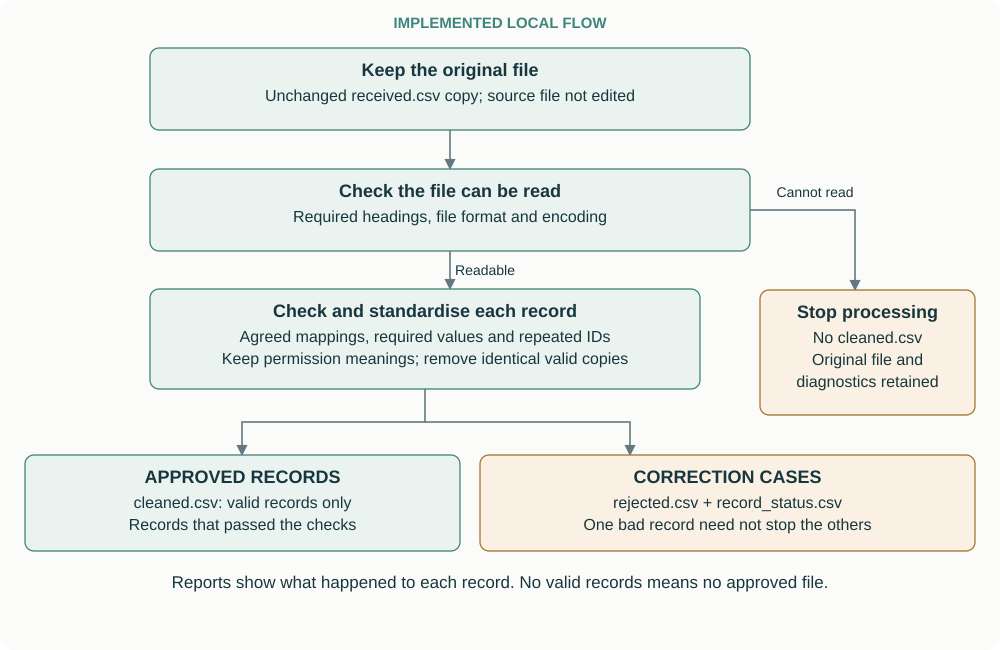
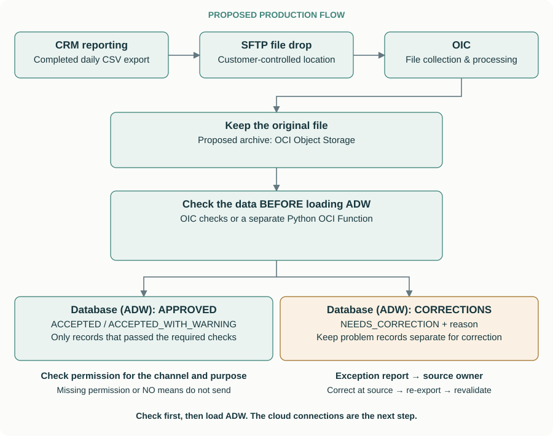

# Reliable CRM CSV ingestion

[Automated validation](https://github.com/swihpi/Assesment/actions/workflows/validate.yml)
A standalone Python program preserves a received CRM CSV, normalizes approved equivalents, releases valid customer records, and reports records needing correction. If the file cannot be interpreted reliably, it blocks release of the entire input. The hypothetical customer is a sports organisation preparing customer data for analytics and later audience decisions. [Customer context and value](docs/customer_note.md).

The standalone Python processor uses only Python's standard library. This is a local demonstration of the same receiving → validation → approved/correction policy proposed for ADW. The Oracle cloud integration and campaign controls are not implemented.

## Result and scope

Start with `samples/bad_values.csv`: four dummy customer records, two released and two needing correction (a missing customer ID and an invalid date). Every input and output can be inspected by hand.

A separate automated test generates 10,000 dummy records, including 800 with missing IDs, and verifies exactly 9,200 released IDs, 800 correction cases and received-byte preservation. It is one of the 60 tests. The same processor handles both datasets; the `--input` file determines how many records it processes. Both cases have been executed; neither is a real customer export.

Independent row errors permit partial release; uncertain mappings or malformed structure block the input. Database destinations must support partial updates: omission cannot mean deletion, and partial files must not replace complete tables.

The working slice is deliberately file-to-file: changing headings, normalization, selection and diagnostics can be reproduced without cloud access. Database reconciliation and campaign eligibility remain deployment work. Passing validation does not prove every source attribute is factually correct.

## Technology key

| Service | Abbreviation | Role in this proposal |
| --- | --- | --- |
| Oracle Integration Cloud | OIC | Retrieve files and coordinate processing. |
| Autonomous Data Warehouse | ADW | Store classified customer records. |
| Oracle Analytics Cloud | OAC | Present information through dashboards. |

## Setup and run in Development or Test

Use Python 3.12 or 3.14; both are checked in clean environments. No third-party packages, credentials, database or cloud connection are required. Git is needed only for cloning; downloading and extracting the repository ZIP is an alternative.

```sh
git clone https://github.com/swihpi/Assesment.git
cd Assesment
python3 --version
```

Start with the four-record demonstration:

```sh
python3 process_export.py --input samples/bad_values.csv --output runs/demo-small
```

Expected result: `READY_WITH_EXCEPTIONS`, two released and two needing correction. Inspect [the input](samples/bad_values.csv), [the released records](examples/with-exceptions/cleaned.csv) and [the two correction cases](examples/with-exceptions/rejected.csv). Unknown permission remains UNKNOWN and does not authorise marketing.

### Verify the separate 10,000-record case

```sh
python3 -m unittest discover -s tests -k ten_thousand -v
```

This selects one automated test that generates and checks 10,000 records. It reports one passing test and deletes its temporary files afterward. [See the test](tests/test_processor.py#L212-L227).

To keep the larger input and outputs for inspection, run:

```sh
python3 tools/large_case_demo.py --output runs/demo-10000
```

This generates the dummy input, invokes the same processor CLI and independently checks the resulting files. It retains `input-10000.csv`, the complete `result/` folder and `verification.json`. The verified result is 9,200 released records and 800 missing-ID correction cases. [Recorded execution](docs/evidence/large-case-current.txt). Each command that writes output requires a new folder.

### Other examples and the complete test suite

```sh
python3 process_export.py --input samples/valid.csv --output runs/dev-valid
python3 process_export.py --input samples/renamed_report.csv --output runs/dev-renamed
python3 -m unittest discover -s tests -v
```

The first two examples each contain three valid records and produce the same cleaned output. The complete suite runs 60 tests, including the 10,000-record test. GitHub Actions also executes the retained demonstration on Python 3.12 and 3.14.

To demonstrate a file-level block, run this separately:

```sh
python3 process_export.py --input samples/breaking_change.csv --output runs/dev-blocked
```

This deliberately returns BLOCKED and **exit code 3**, because a required heading has no approved mapping. No cleaned CSV is produced. This is expected rejection, not a crash; chaining further commands with `&&` would stop there. Exit 1 indicates an operational/configuration failure. Invalid command syntax uses exit code 2; blocked processing uses 3. File-level blocking reasons are printed to stderr and retained in the reports.

**Never test a new script or mapping in Production first.** Use dummy inputs locally, then validate the deployed integration in a dedicated Development/Test environment before reviewed Production promotion. [Deployment approach](docs/deployment.md).

## Processing contract

All six headings must exist, using canonical names or approved aliases:

| Field | Rule |
| --- | --- |
| `customer_id` | Required ID; preserve leading zeroes. |
| `name` | Required; tidy whitespace. |
| `region` | Required; tidy whitespace without inventing geography. |
| `member_since` | Required real date in `YYYY-MM-DD`. |
| `last_purchase_date` | Same date format or empty. |
| `marketing_permission` | Approved values become YES/NO; missing or unfamiliar values stay UNKNOWN with a warning. |

Readable CSV mappings in `config/` define heading aliases and permission equivalents. Their required headers are `source_column,output_column` and `source_value,output_value`, respectively. Empty files, header-only files, malformed rows, duplicate or empty keys and unsupported targets fail configuration validation before a run folder is created; messages identify the file and row where available. Approved heading changes and reordered columns work; an extra unused column warns. A missing/ambiguous required heading, wrong record width, broken quoting, unsupported encoding or empty input blocks the input. Even a valid prefix of a structurally broken file is not released.

For a fully parsed file, missing/invalid required values and conflicting records for the same customer ID affect those records, while valid records are released. When repeated records have the same customer ID and the same values after tidying, one valid copy is retained. Invalid copies still need correction. Empty CSV records are counted and rejected for missing required values; only blank physical lines are skipped. Permission mapping keys and incoming values use the same case and whitespace normalization. Names and regions use Unicode NFC normalization before comparison; customer IDs retain exact, case-sensitive matching after surrounding whitespace is trimmed. Identical invalid duplicates retain their field-level errors, and genuine ID conflicts include any field-level errors in the correction report. A new heading such as `customerdata_id` initially blocks release; only after source-owner confirmation should its alias to `customer_id` be added and tested. A change in identifier meaning or values needs identity reconciliation, not a spelling substitution.



Conflicting attributes under one ID can describe inconsistent records for the same customer. The prototype leaves that group out of the approved file until the source owner resolves the differences. For example, a report joining current and previous addresses can repeat F002 with NY on one row and CA on another, even when the CRM customer table has only one F002. Different IDs such as F002 and F012 are not matched as one person by this processor.

## Outputs, record status and completion

Every readable source is copied byte for byte to `received.csv` before parsing. The original source remains unchanged. The run folder identifies the import batch; `record` refers to a CSV data record in source order, excluding blank physical lines. Correctly shaped records containing empty fields are included. Reports also provide `source_line_start` and `source_line_end`, including for quoted multiline records. Locations remain blank when buffered decoding cannot reliably identify the failing line.

| Output | Purpose |
| --- | --- |
| `received.csv` | Exact received bytes, including records excluded from approved output. |
| `cleaned.csv` | Approved normalized records only; exists only for a releasable run. |
| `record_status.csv` | Source-record reference, available customer ID, validation status and reason. |
| `rejected.csv` | File/record, field, problem and corrective action. |
| `warnings.csv` | Unknown permission, unused columns and ignored identical duplicates. |
| `summary.txt`, `run.log` | Parsing completeness, counts, released records, outcome, duration and stages; processor version, UTC start timestamp and SHA-256 of the received bytes. |

Record statuses are ACCEPTED, ACCEPTED_WITH_WARNING, NEEDS_CORRECTION, or DUPLICATE_IGNORED. A valid candidate in an incompletely parsed input is NOT_RELEASED. Missing IDs are traceable through the batch and source-record reference; these are tracking references, not invented customer identities.

| Run status / final marker | Result | Exit |
| --- | --- | --- |
| `READY` | Complete input; approved output; no rejected records. Warnings may exist. | 0 |
| `READY_WITH_EXCEPTIONS` | Complete input; approved output plus correction cases. | 0 |
| `BLOCKED` | Input cannot be interpreted completely, or no valid records remain; no approved output. | 3 |

The `warnings` count is the number of warning entries across received records, including records later rejected or deduplicated. It is not a count of released customers with warnings.

The completion marker is written **last**, after reports and any cleaned output. Consumers must require READY or READY_WITH_EXCEPTIONS before using `cleaned.csv`. No marker means incomplete output, even if a file is present. BLOCKED inputs retain their received copy and available diagnostics. A missing/unreadable source or failed configuration may stop before a run folder can be created.

For complete input: **parsed records = valid records + rejected records + identical duplicates removed**. For blocked input, `released_records` is zero; `valid_records` may describe candidates seen before a parsing failure and is not evidence of release.

## Diagnostics and compatibility in version 1.1.0

`BLOCKED` now exits 3 instead of 2. Update callers that check the old code. READY and READY_WITH_EXCEPTIONS still exit 0, operational/configuration errors exit 1, and invalid command syntax exits 2. The correction, warning and status CSVs append two physical-line columns; consumers should read by heading rather than assume a fixed column count. The cleaned customer CSV keeps its existing six-column schema.

Use `python3 process_export.py --version` to inspect the processor version. Add `--debug` to a processing command for a traceback. Expected errors have concise messages; unexpected programming errors identify their exception type and suggest debug mode.

For operational failures after this process creates the output folder, it attempts to append the error to `run.log`. A full disk or other storage failure may also prevent logging. No new FAILED marker is introduced; consumers still require a successful completion marker. Existing output folders and their logs are never reused. The snapshot hash identifies the received bytes; it does not prove the source remained stable during copying. Supply a completed source file.

## An actual actionable error

This row is taken from `rejected.csv` produced by the bad-value example. Record 3 means the third nonblank source record, not necessarily a physical CSV line.

| Record | Customer ID | Field | Code | Message | Next action |
| --- | --- | --- | --- | --- | --- |
| 3 | F003 | member_since | INVALID_DATE | Joining date is not a valid YYYY-MM-DD calendar date. | Confirm joining date in the authoritative CRM record, correct it and re-export. |

Messages and next actions identify the particular missing field or invalid date. Several problems remain combined into one report row per rejected record. The source owner confirms and corrects the joining date in the CRM and re-exports; the processor does not guess a replacement. Repeated IDs with inconsistent records use `CONFLICTING_RECORDS_FOR_ID`; the program does not establish that distinct identities exist.

## Data quality and marketing eligibility

NO means explicit opt-out; UNKNOWN means missing or unrecognised permission. We preserve that distinction. For a campaign that requires confirmed permission, neither NO nor UNKNOWN allows a message to be sent. An identifiable record with unknown permission can be released with a warning; it is not thereby eligible for marketing. The single permission field is a demonstration simplification: email permission does not authorise push, SMS or WhatsApp. Production activation must check current channel/purpose permission, address/device validity and other agreed rules.

The script does **not** implement campaign selection or send messages. In production, access to the approved customer selection and campaign-specific filters must enforce the restrictions; a flag that downstream exports can ignore is insufficient.

## Proposed production deployment and correction



**Demonstration choice:** local Python and CSV files make the processing policy reproducible without Oracle platform access. **Production recommendation:** assess native OIC mappings and controls first; use a separately hosted Python function where the validation, duplicate-handling and diagnostic requirements justify it.

The assumed CRM has no usable API or supported application-specific connector, but supports scheduled CSV reports and SFTP delivery. OIC retrieves the completed file, archives the original bytes in a restricted raw-file location (proposed: OCI Object Storage), and coordinates validation before database loading. It then writes classified approved records and restricted correction cases into ADW, with status and reason. The diagram illustrates Python hosted in an OCI Function; its handler and cloud I/O still need implementation. The raw archive preserves the exact file, including malformed input; ADW retains readable classified records while an approved selection excludes correction cases. Exception storage must accommodate invalid values as source data, rather than forcing an invalid date into a date column. Campaign eligibility is a further check.

For 10,000 fully parsed records with 800 independent required-value failures and no duplicates, the local demonstration preserves all 10,000 in `received.csv`, releases 9,200 in `cleaned.csv`, and reports 800 correction cases. A test verifies this exact scenario. The proposed ADW deployment applies the same policy. It requires a destination that supports partial updates: omitted rows must not mean deletion, and a partial file must never blindly replace a complete customer table. Reconciliation, updates to existing customers and correction replay remain deployment work.

The CRM/data owner owns source correction; the integration owner owns mappings and processing. An exception report should be securely routed to the responsible owner, corrected at source, re-exported and revalidated, with unresolved counts and age tracked. The script produces diagnostics; report delivery, workflow assignment and recovery tracking are proposed. Missing permission remains UNKNOWN unless authoritative evidence resolves it.

## Verification, performance and limits

**60 automated tests** cover expected output, heading drift, required fields/dates, NO/UNKNOWN, duplicates, malformed input, encoding, reruns, write failures, source retention, approved alias changes and the 10,000/800 case. [Expected outcomes](samples/expected_outcomes.md) · [Validation evidence](docs/validation.md).

```sh
python3 tools/benchmark.py --sizes 1000 100000 --output runs/benchmark.csv
```

Single local runs of processor version 1.1.0 measured 1,000 records in 0.051 seconds and 100,000 in 0.595 seconds, with output counts independently verified. Python 3.14.4 on macOS 26.6.2. The timer includes startup, snapshot copying, processing and report writing; generation and independent output counting are outside it. The raw measurements record the processor SHA-256 and UTC timestamp. Memory grows with retained records; these measurements do not establish Production/cloud capacity or a supported memory ceiling. [Raw benchmark results](docs/benchmark.csv).

No live extraction, schedule, ADW load, cloud status management, source locking, exactly-once delivery, automated correction, sentiment model or campaign enforcement is implemented. The caller must provide a completed file. Source retention makes local outcomes inspectable; Production access, retention and deletion rules remain customer decisions. Reprocessing uses a fresh run folder, not an append operation. [Walkthrough](docs/walkthrough.md).

## My judgement and Codex assistance

### How I approached the assignment

Analytical thinking and problem solving are central to how I work. I break a problem down, question the assumptions and consider different approaches before deciding what makes sense. I am fascinated by AI and how it can help me personally and professionally, but I do not take its output at face value: I ask for sources when factual claims are made, check whether the reasoning holds up and revisit answers when something does not feel right. For this assignment, I brought my Oracle experience and the original NHL idea, then used Codex to develop and test the hypothetical CRM example. I kept questioning whether the proposed behaviour would help the customer and whether the code, diagrams and explanation agreed.

### Questions that changed the result

| Question I raised | What changed |
| --- | --- |
| How does the CRM export actually reach OIC? | We made the scheduled export, delivery to SFTP and OIC collection explicit. |
| Why use unfamiliar database programming or make the script unnecessarily long? | We kept a standalone Python example that reviewers could run without Oracle access. |
| Why should 800 bad records prevent use of 9,200 others? | We changed the policy to allow valid records through, provided the receiving system can safely accept partial updates. |
| Why do the diagram and code describe different behaviour? | I challenged the mismatch and required the implementation, tests, diagrams and documentation to agree. |
| Who corrects missing data, and should missing permission become NO? | We identified the responsible source owners and kept missing permission as UNKNOWN. |
| Could the generated code still have gaps despite passing the initial checks? | I requested code reviews with both Codex and Claude. The reviews identified skipped empty records, inconsistent handling of spaces in permission values and duplicate reports that hid other errors. Fixes and regression tests followed. |

On occasions I asked Codex to assess Claude’s feedback point by point. I accepted changes to configuration checks, text matching, error messages and traceability while keeping the agreed release policy. Rather than rely on an assurance that the repository would work for someone else, I requested a fresh-copy test on my Mac.

### Where AI helped, and where I kept clear limits

Codex generated the Python implementation and automated tests, including technical failure cases I would not have identified myself. I focused my review on the customer rules and reported outcomes, and requested further reviews with both Codex and Claude. I did not independently review every test assertion. The passing tests provide evidence for the behaviours checked, rather than a guarantee that the code has no gaps.

I chose Codex because it allowed me to work with documents, code and execution results in one place. It helped with the scenario, research, dummy data, code, tests, documentation and execution, while feedback from Claude also informed the review. I remained responsible for the intended behaviour, the questions asked and whether the reported results made sense. The walkthrough explains the main mechanisms behind those decisions so they can be discussed and reproduced.

The running processor does not call an LLM. Agreed mappings, required values and date checks should give repeatable results. AI could help investigate an unfamiliar field, but the source owner still needs to confirm its meaning before a mapping is approved. Neither AI nor the integration should invent a missing customer ID or marketing permission, and I would only introduce an agent into the daily process if it solved a clear customer problem and its output could be checked reliably.


## How this submission addresses the assignment

This submission was developed around the assignment’s requirements: a small, coherent ingestion and normalisation flow, runnable code with setup instructions, explicit assumptions and trade-offs, actionable errors, meaningful tests, basic observability, and performance considerations. The README documents how AI was used and where human confirmation remains necessary. Production capabilities outside the working slice are identified separately. The table below links each requirement to the corresponding implementation or evidence.

| Requirement from the brief | Implementation or evidence |
| --- | --- |
| “cope with schema drift and bad data while surfacing clear, actionable errors” | Confirmed heading mappings, field checks, record-level correction cases and file-level blocking are implemented. [Processor](process_export.py) |
| “runnable code, a README with setup and run instructions, assumptions, architecture overview, trade-offs, and known limitations” | The repository provides runnable code, exact commands, expected outcomes, diagrams and documented boundaries. |
| “a short note describing the customer context you assumed and the value your solution would create” | The sports-organisation scenario, source constraints and intended value are explicit; the customer incident is hypothetical. |
| “the goal is not to build a production-grade system” | The working scope is local file processing. Cloud retrieval, database updates and campaign execution remain proposed extensions. [Scope and limitations](README.md#result-and-scope) |
| “A small but coherent end-to-end slice is preferred” | A completed CSV becomes preserved input, normalised approved output, correction reports and a final completion status. [Inspectable outputs](examples/with-exceptions) |
| “clarity of design, code quality, reasoning, and trade-offs rather than alignment to a specific stack” | Standard-library Python makes the demonstration reproducible without cloud access. The design explains mapping approval, partial release and conservative conflict handling. [Processing contract](README.md#processing-contract) |
| “where AI was used, how it was used, and where you deliberately chose not to rely on it” | The README describes Codex assistance and human review. Runtime decisions use deterministic rules; unfamiliar source meanings require human confirmation. [AI disclosure](README.md#my-judgement-and-codex-assistance) |
| “A small but meaningful test set covering core behavior is preferred” | Automated tests cover selected core behaviour and regression cases, with expected outputs and reproducible execution evidence. [Tests](tests) |
| “basic logging and minimal observability that fits the shape of the system” | Logs, counts, statuses, source references, diagnostics and completion markers support troubleshooting of local runs. [Outputs and completion](README.md#outputs-record-status-and-completion) · [Example run log](examples/with-exceptions/run.log) |
| “identify likely bottlenecks, have a sensible measurement strategy, and can explain how the design would scale” | A reproducible benchmark verifies counts and records its environment. Retained records are identified as the memory bottleneck; local timings are not production-capacity claims. [Benchmark tool](tools/benchmark.py) |

### Submission checklist against the brief

This checklist confirms that the submission addresses the deliverable requirements and engineering expectations in the assignment brief. Each checked item is supported by the implementation or evidence linked above.

- [x] Runnable ingestion and normalisation flow handling schema drift and bad data.
- [x] Clear, actionable errors identifying the affected record, field, problem and corrective action.
- [x] Git repository with setup and run instructions.
- [x] Documented customer context, assumptions and intended value.
- [x] Architecture, technology choices, trade-offs and known limitations explained.
- [x] A coherent file-to-file implementation, with production extensions explicitly outside scope.
- [x] AI assistance, human review and deliberate limits on AI reliance documented in the README.
- [x] Meaningful automated tests covering core behaviour and failure cases.
- [x] Basic logging, processing summaries and traceable diagnostics.
- [x] Performance measurements, likely bottlenecks and scaling considerations documented.
