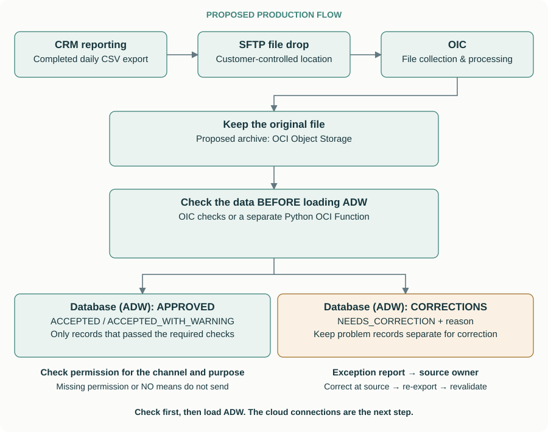
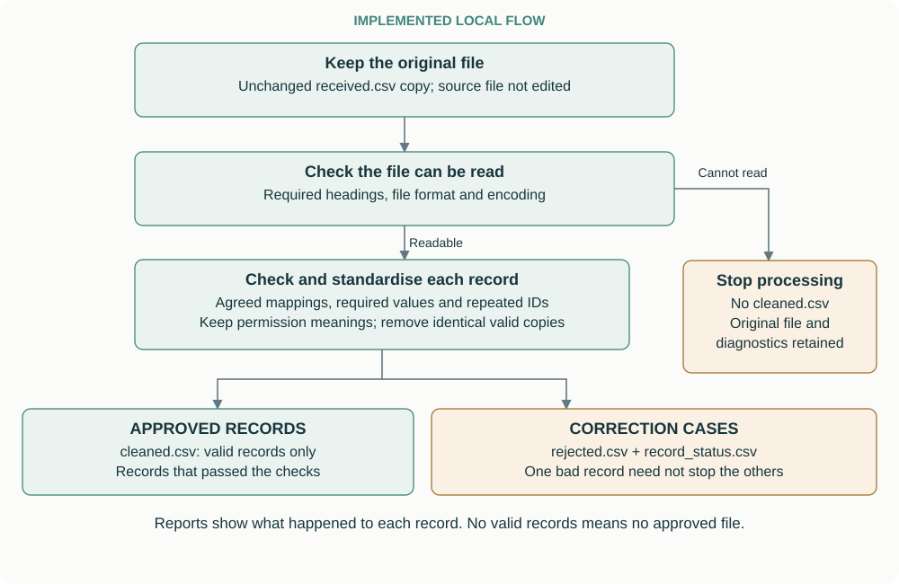
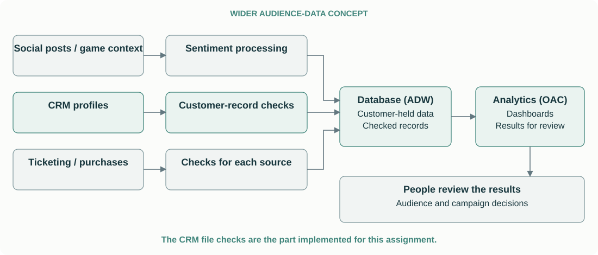

# From CRM exports to usable customer data.

## The customer problem and my approach

A sports organisation wants to combine information from its CRM with other customer data for reporting and future marketing activities. Its CRM can produce a daily CSV export, but the receiving team cannot always rely on it. Report headings change, some fields are empty, and records for the same customer sometimes contain different information. Receiving the file is therefore only the first step: the team also needs to know which records can be used, which need correcting and who should deal with those corrections.

For this exercise, I focused on that part of the problem. The demonstration keeps the original file, checks and standardises its contents, and produces an approved customer file together with reports explaining any problems. If the file cannot be read or understood reliably, it does not release an approved file.

### What the demonstration shows

The smaller example contains four dummy customer records. Two pass the checks and two need correction: one has no customer ID, and another has an invalid joining date. One of the accepted records has no confirmed marketing permission. That record can still be retained, but it must not be treated as permission to contact the customer.

A separate example uses 10,000 dummy records, including 800 with missing customer IDs. It checks that all received records are kept, the correct 9,200 records are released, and the other 800 are reported for correction. Both examples have been run using the same processor. The larger example checks the rules with more records; its error rate was chosen for the exercise and does not represent a real customer’s data quality.

### Why use a daily CSV?

For this example, I assumed that the legacy CRM has no usable API or supported application connector. It can, however, produce a scheduled report and send the file to SFTP. That gives us a practical starting point without first having to replace the CRM. Where the business needs customer changes reflected within seconds or minutes, and the source supports it, I would prefer a streaming connection. The same questions about field meanings, missing information and marketing permission would still apply, with additional work needed to handle repeated updates, their order and recovery after a failure.

### Why this scope?

My preference for a customer solution would be to automate the process: collect the export, run the checks and deliver the results without someone having to execute commands each day. OIC would be my starting point for coordinating that flow. For the assignment, I have provided the Python script on GitHub so the reviewers can run the example themselves, without needing access to an Oracle environment.

The working example starts with a completed CSV and ends with an approved CSV, correction reports and a clear processing result. This covers the part of the problem where the incoming data is checked and made usable. Automated collection from SFTP and loading into ADW are explained as the next steps; they have not been built as part of this demonstration.

[Coverage against the brief →](#how-the-submission-addresses-the-assignment)

### Oracle services used in the proposal

| Service | Abbreviation | Role |
| --- | --- | --- |
| Oracle Integration Cloud | OIC | Collect the file and coordinate the steps from source to destination. |
| Autonomous Data Warehouse | ADW | Store the customer records and the records that need correction. |
| Oracle Analytics Cloud | OAC | Present the information through dashboards. |

### Main decisions and why I made them

| Decision | Reason |
| --- | --- |
| Work with the CRM’s existing CSV export | The assumed CRM has no usable API or supported connector, but it can deliver a scheduled report. |
| Recognise columns by their agreed names | Reordering columns should not break the process. A new name must be confirmed before we assume it means the same thing. |
| Keep the original file | We need to inspect what arrived and explain what happened to each record. |
| Release records that pass the checks | An error in one record should not automatically stop all other records, provided the receiving system can safely accept a partial update. |
| Stop the whole file when its structure or required headings cannot be trusted | We should not load records when we cannot reliably tell what the file contains. |
| Provide standalone Python for the demonstration | Reviewers can run and inspect the behaviour without Oracle services or cloud credentials. |

### The experience behind the case

The assignment reminded me of a Social Media Sentiment Analysis initiative I helped start at Oracle. We informally called the group the OCI Think Tank. It began with Mark, an Oracle US sales representative, and me, with the idea of experimenting with customer solutions that could create commercial value for customers while also generating Oracle cloud revenue. We brought together colleagues from EMEA and the US with integration, analytics, product-management and database experience.

I pushed the sentiment-analysis use case internally, contributed to the architectural direction and considered which Oracle services could support it. I also created several OAC dashboards. I understood what OIC could contribute, although I did not configure the integrations myself, and a colleague set up the database sentiment analysis.

The wider ambition was to combine social-media sentiment with other information a customer might hold, such as individual profiles, ticket purchases and merchandise transactions. We considered both batch and streaming data, with a preference for using OIC to automate the flow from each source to the destination. This could help an organisation decide where to spend its advertising and promotion budget, when to communicate and which audiences or customers to approach through email, push notifications, WhatsApp or SMS. The aim was to help customers generate more relevant engagement and revenue while keeping the data and analysis in their own environment.

For this assessment, I have taken one part of that wider idea: making customer information from a CRM usable before it is combined with other sources.

## Getting the file from the CRM

The first conversation with the customer would establish what the CRM can reliably provide, who owns the export and how the receiving team uses it. In this example, there is no usable API or supported application connector, including through OIC. The CRM can create a daily report and deliver it to a customer-controlled SFTP location. At 02:00 UTC, it exports customer ID, name, region, joining date, last-purchase date and marketing permission; OIC would collect the file once delivery is complete.

### Proposed automated flow



This is the proposed customer setup. OIC would collect the file and coordinate the checks before loading ADW, using its own capabilities where suitable or calling a separate Python function where needed. For example, a record with valid customer details but no confirmed marketing permission could be stored as ACCEPTED_WITH_WARNING: it passes the required data checks, but permission remains unknown. An exported record with a joining date of 2024-02-30 would be marked NEEDS_CORRECTION and kept out of the approved selection until the value is confirmed and the export corrected.

### What goes wrong in this example?

In this example, a report-template change introduces different headings, a different column order and repeated customer rows. The export also contains missing or invalid values that the existing process had not caught. We confirm field meanings with the source owner before approving mappings, rather than assume that similar-looking headings mean the same thing.

The expected export contains one row per customer. A report that includes both current and previous addresses could accidentally produce two rows for the same customer ID, each with a different region. The customer table can still have one unique record for that ID; the repeated rows are introduced when the report is assembled. This is a hypothetical explanation for the exercise, not a fault the processor can diagnose.

The checks apply to the exported file. A missing ID means the export has not supplied the required identifier; it does not prove that the customer has no database ID. Similarly, an invalid date could come from a text field, imported legacy information or an export transformation, rather than a database date column. The source owner investigates whether to correct the customer information, report configuration or export mapping.

## How the records are checked

The export must contain all six agreed columns. Customer ID, name, region and joining date must contain values that pass the selected checks; last-purchase date may be empty. The column mappings and accepted marketing-permission values are kept in readable CSV configuration files. We do not guess the meaning of an unfamiliar heading or create an ID to make a record pass.

### Processing rules

| What arrives | What the processor does | Example |
| --- | --- | --- |
| An approved alternative heading, or columns in a different order | Recognises the column through the mapping file and continues. | Full Name maps to name; moving it from column two to column five does not change the result. |
| An extra column that is not used | Reports a warning and continues. | The CRM adds loyalty_level. The processor reports that it is unused and continues. |
| A required heading is missing, two columns map to the same field, or the CSV cannot be read properly | Stops the whole file, keeps the original and explains the problem. | customer_id becomes customerdata_id without an approved mapping. The file stops until the meaning is confirmed. |
| A customer record has a missing required value or invalid date | Reports that record for correction and releases the other records that pass. | A customer has no ID, or a joining date of 2024-02-30. That record needs correction; other records can pass. |
| An otherwise valid customer entry appears more than once with the same values after basic tidying | Keeps one approved copy and reports that the extra copy was ignored. Identical entries with invalid values still need correction. | F001 appears twice with identical details that pass the checks. One copy is retained. If both copies have an invalid joining date, neither is approved. |
| Records share a customer ID but contain different values | Reports the records for correction rather than deciding which one is right. | An address report exports F002 twice: once with previous region NY and once with current region CA, without saying which is current. Both rows need review. |
| Marketing permission is missing or unclear | Keeps the value as UNKNOWN, reports a warning and retains the record if its other required fields pass. UNKNOWN does not mean that marketing is allowed. | F004 has valid customer details but an empty permission field. It is retained with UNKNOWN and a warning. |

### The working local flow



### What happens when 800 of 10,000 records fail?

I questioned why correcting 800 records should prevent the customer from using the other 9,200. Whether we can release those records depends on the receiving system: it must be able to accept individual updates without assuming that missing customers should be deleted. In the tested example, `received.csv` keeps all 10,000 records, `cleaned.csv` contains the 9,200 that pass, and the correction reports identify the 800 needing attention.

There are situations where stopping the complete update would be the right choice. A receiving system might replace its entire customer table from each file, for example, so loading only part of the export could remove customers unintentionally. That behaviour must be agreed before enabling partial updates. If a required column is missing, the file cannot be read reliably, or none of the records pass, no approved CSV is produced.

A row without a customer ID can still be traced through the file and its record number. That helps the owner locate the problem without creating an artificial customer identity.

### What if records for the same customer disagree?

When the export contains different values under the same customer ID, the rows may describe one customer with current and outdated information. For example, a report could include both the customer’s current and previous region without identifying which is current. The demonstration reports CONFLICTING_RECORDS_FOR_ID and leaves those rows out of the approved file. It cannot determine the cause or choose the correct value from the supplied information.

In a wider solution, we could agree that System A takes priority over System B for particular fields, or use a confirmed update time to decide which information is current. Those rules need agreement with the customer. This exercise does not implement them, so the processor does not choose a winner.

The processor compares records that share the same customer ID. If Alex Morgan appears under F002 and F012, it treats those as separate IDs. It does not determine whether they belong to the same person; that would require additional information and matching rules.

### Marketing permission is a separate question

For this exercise, I assumed one marketing-permission flag in the CRM export. In a real customer environment, permission may be recorded separately for email, SMS, push notifications and other purposes. Here, the single flag lets me demonstrate how the process handles YES, NO and missing or unclear permission without building a wider consent-management solution. A customer record can pass the data checks without being suitable for a marketing message: NO means an opt-out, while UNKNOWN means permission is missing or the supplied value is not recognised. For a campaign that requires confirmed permission, neither is enough to send a message.

| Value | What it means | What happens before marketing |
| --- | --- | --- |
| YES | The CRM export records permission under the single marketing flag assumed for this exercise. | Continue with the other campaign checks. Passing the import alone is not approval to send. |
| NO | The customer has opted out. | Do not use the record for the affected marketing activity. |
| UNKNOWN | Permission is missing or cannot be interpreted reliably. | Do not send where confirmed permission is required. Ask the responsible owner to clarify it. |

### What if customer_id changes to customerdata_id ?

The processor initially stops the file because it does not have an approved mapping for that heading. The source owner needs to confirm whether this is only a name change and whether the values still identify customers in the same way. If confirmed, the integration owner adds the mapping below, tests it in Development/Test and processes the export again.

```sh
customerdata_id → customer_id
```

An automated test checks the result before and after adding the mapping. If the identifiers themselves have changed, renaming the column is not enough; we would need an agreed way to link the old and new IDs.

## Demonstration and evidence

The Python processor uses only Python’s standard library. Reviewers can run it without cloud credentials, a database or additional packages. My preferred way of executing these checks is through Codex: I provide the commands or describe what I want checked, then review the results against the expected outcome. The README also contains the commands so another engineer can reproduce the examples directly.

### Two examples

| Example | Input | Verified result |
| --- | --- | --- |
| Small example that can be inspected by hand | Four dummy records in `samples/bad_values.csv` | Two records released; two need correction. |
| Larger verification | 10,000 generated dummy records, including 800 missing IDs | Exactly 9,200 records released; 800 need correction; original received file retained. |

```sh
# Small example: four records, two released and two needing correction
python3 process_export.py --input samples/bad_values.csv --output runs/demo-small

# Run the test that generates and checks 10,000 records
python3 -m unittest discover -s tests -k ten_thousand -v

# Keep the larger input and its outputs for inspection
python3 tools/large_case_demo.py --output runs/demo-10000
```

The automated test uses a temporary folder and removes its files afterwards. The retained larger demonstration keeps the dummy input, processed output and verification results under `runs/demo-10000`, so reviewers can inspect them. It checks the file counts, confirms that the received copy matches the input and verifies the exact customer IDs released.

[View the full Python code on GitHub ↗](https://github.com/swihpi/Assesment/blob/main/process_export.py)

```python
for field in ("member_since", "last_purchase_date"):
    if row[field]:
        try:
            valid_format = re.fullmatch(r"[0-9]{4}-[0-9]{2}-[0-9]{2}", row[field])
            if valid_format:
                date.fromisoformat(row[field])
            else:
                problems.append((field, "INVALID_DATE"))
        except ValueError:
            problems.append((field, "INVALID_DATE"))
```

Sample of the Python script

### How I run and review the demonstration

I use Codex to execute the examples and tests, then compare the reported results with what I expected. The valid and renamed exports each release the same three customer records. The bad-value example releases F001 and F004 and reports two records for correction, while an unrecognised required heading stops the file. This allows me to repeat the checks through the Codex conversation while keeping the reproduction instructions available for reviewers.

<picture: available in the private presentation>

[Read the execution log](evidence/codex-run-current.txt)

### One record that passes

| Field | Received | After processing |
| --- | --- | --- |
| Customer ID | F001 with surrounding spaces | F001 |
| Full Name | Alex and Morgan separated by repeated spaces | Alex Morgan |
| Home Region | NY with surrounding spaces | NY |
| Email Opt In | y with surrounding spaces | YES |
| Customer Since | 2022-04-15 | 2022-04-15 |

The date keeps its original meaning. Another record has no last-purchase date and still passes because that field is optional.

### One record that needs correction

The bad-value example contains the joining date `2024-02-30`, which does not exist. The report identifies the customer, affected field and action needed, as shown below. The source owner must confirm the correct date; simply replacing it with a date that passes the format check could introduce a different error. If a record has several problems, they are kept together in one report row.

| Record | Customer ID | Field | Code | Message | Next action |
| --- | --- | --- | --- | --- | --- |
| 3 | F003 | member_since | INVALID_DATE | Joining date is not a valid YYYY-MM-DD calendar date. | Confirm joining date in the authoritative CRM record, correct it and re-export. |

### Results from the supplied examples

| Example | Result |
| --- | --- |
| Valid export | Three records released. |
| Renamed or reordered report | The same three expected records released. |
| Export containing bad values | F001 and F004 released; two records need correction. |

### Files produced

| Output | Purpose |
| --- | --- |
| `received.csv` | An unchanged copy of the file that arrived. |
| `cleaned.csv` | Records that passed the checks. |
| `record_status.csv` | What happened to each source record. |
| `rejected.csv` | Problems that need correction, with messages and next actions. |
| `warnings.csv` | Issues that need attention but do not necessarily prevent release. |
| `summary.txt` and `run.log` | Counts, processing result and information for troubleshooting. |

### Testing and troubleshooting

The automated checks cover the main processing rules, including changed headings, missing values, invalid dates, repeated customer records and files that cannot be read properly. They also check that the original file is kept and that the correct records appear in the output. When something goes wrong, the reports and log help identify the file, affected record, problem and next action. The README provides the commands and expected results for reviewers to repeat these checks.

### Performance and scaling

| Dummy input | Verified output | Recorded time |
| --- | --- | --- |
| 1,000 records | 1,000 records | 0.051 seconds |
| 100,000 records | 100,000 records | 0.595 seconds |

These were individual local measurements using Python 3.14.4 on macOS 26.6.2. The timer includes starting the program, copying the input, checking the records and writing the reports. Generating the dummy input and independently counting the output happen outside the timer. The saved results identify which script was measured and when the measurement was taken.

The larger example ran quickly on my Mac, but I would repeat the measurements in the intended customer environment before agreeing what it could handle. The program keeps records in memory while checking repeated customer IDs and preparing reports.

## How I would automate this for a customer

The Python script gives reviewers a working example they can run independently. For a customer, my preference would be to automate the flow through OIC. I would first check whether its own mappings and controls meet the validation and reporting requirements. Where custom Python is justified, OIC can call a separately hosted OCI Function.

### Keep the original, then check before loading

In the proposed setup, OIC collects the completed SFTP export and keeps the original in a restricted archive, with OCI Object Storage as the proposed location. It then coordinates the checks before loading customer records into ADW. Records that pass become available for further use, while records needing correction are kept separately with their status, reason and source reference. These cloud connections, database updates and access controls have not been implemented in this exercise.

| Record condition | Proposed ADW status | How it can be used |
| --- | --- | --- |
| Required fields pass the checks | ACCEPTED | Available for further reporting or eligibility checks. It is not automatically approved for marketing. |
| Missing customer ID, invalid required date or conflicting records under one ID | NEEDS_CORRECTION | Available to the people investigating the problem; excluded from the approved customer selection. |
| Required fields pass, but marketing permission is missing or unclear | ACCEPTED_WITH_WARNING | Retained as a customer record, but excluded from campaigns requiring confirmed permission. |

For example, an exported record with a joining date of 2024-02-30 would be marked NEEDS_CORRECTION because that date does not exist. It would be kept for investigation and left out of the approved customer selection. A record with valid customer details but an empty marketing-permission field would be marked ACCEPTED_WITH_WARNING. It can be retained, but it cannot be used for a campaign that requires confirmed permission.

The local files show the same separation. `received.csv` represents the original archive, `record_status.csv` records the decisions, `cleaned.csv` contains the approved selection, and `rejected.csv` explains the corrections needed. The correction area must also retain the problem value in a form that can be inspected; an invalid date, for example, needs to be stored as source text rather than forced into a database date field.

### Who fixes the data?

When an import has problems, the customer needs a practical update: what can still be used, what needs attention, who is investigating and when the next update will be provided. We should distinguish incorrect source information from a failure in the processing itself. I would avoid promising a resolution time before we understand the cause, but make sure the customer knows who is working on it and what happens next.

### What happens to earlier customer information?

A corrected export must not overwrite a newer customer update or a more recent permission change. We also need a rule for a customer who passed yesterday but fails today. Keeping yesterday’s record does not automatically make it safe for marketing, particularly if today’s failed update contains a permission change. Those database update rules need to be agreed before production use; the local processor does not implement them.

### Test before production


I would not test a new script, mapping or integration in production first. Development/Test should cover completed-file detection, missing exports, connectivity, permissions, retries, the original-file archive, database loading, partial updates, correction handling and restrictions on downstream use. After successful validation and review, the flow could be promoted to production with separate configuration and monitoring. Only the local stage has been exercised here, using dummy data.

### What remains outside the demonstration?

The working example does not implement live CRM extraction, SFTP collection, daily scheduling, ADW loading or updates to existing customer records. It also does not deliver correction reports automatically, manage their assignment, guarantee that a file is applied exactly once, or perform sentiment scoring and campaign delivery. These are further implementation steps around the demonstrated processing rules.

A daily export would also be insufficient where immediate permission changes must be reflected. Marketing activity needs a suitable check of current permission. If problems repeatedly originate in the CRM, I would review the report configuration, change ownership and available interfaces with the customer. Fixing the report may be enough; replacing the CRM would be a separate recommendation, weighed against cost and disruption.

## My judgement and Codex assistance

### How I approached the assignment

Analytical thinking and problem solving are central to how I work. I break a problem down, question the assumptions and consider different approaches before deciding what makes sense. I am fascinated by AI and how it can help me personally and professionally, but I do not take its output at face value: I ask for sources when factual claims are made, check whether the reasoning holds up and revisit answers when something does not feel right. For this assignment, I brought my Oracle experience and the original NHL idea, then used Codex to develop and test the hypothetical CRM example. I kept questioning whether the proposed behaviour would help the customer and whether the code, diagrams and explanation agreed.

### Questions that changed the result

| Question I raised | What changed |
| --- | --- |
| How does the CRM export actually reach OIC? | We made the scheduled export, delivery to SFTP and OIC collection explicit. |
| Why use unfamiliar database programming or make the script unnecessarily long? | We kept a standalone Python example that reviewers could run without Oracle access. |
| Why should 800 bad records prevent use of 9,200 others? | We changed the policy to allow valid records through, provided the receiving system can safely accept partial updates. |
| Why do the diagram and code describe different behaviour? | I challenged the mismatch and required the implementation, tests, diagrams and documentation to agree. |
| Who corrects missing data, and should missing permission become NO? | We identified the responsible source owners and kept missing permission as UNKNOWN. |
| Could the generated code still have gaps despite passing the initial checks? | I requested code reviews with both Codex and Claude. The reviews identified skipped empty records, inconsistent handling of spaces in permission values and duplicate reports that hid other errors. Fixes and regression tests followed. |

On occasions I asked Codex to assess Claude’s feedback point by point. I accepted changes to configuration checks, text matching, error messages and traceability while keeping the agreed release policy. Rather than rely on an assurance that the repository would work for someone else, I requested a fresh-copy test on my Mac.

### Where AI helped, and where I kept clear limits

I chose Codex because it allowed me to work with documents, code and execution results in one place. It helped with the scenario, research, dummy data, code, tests, documentation and execution, while feedback from Claude also informed the review. I remained responsible for the intended behaviour, the questions asked and whether the reported results made sense. The walkthrough explains the main mechanisms behind those decisions so they can be discussed and reproduced.

The running processor does not call an LLM. Agreed mappings, required values and date checks should give repeatable results. AI could help investigate an unfamiliar field, but the source owner still needs to confirm its meaning before a mapping is approved. Neither AI nor the integration should invent a missing customer ID or marketing permission, and I would only introduce an agent into the daily process if it solved a clear customer problem and its output could be checked reliably.

## The wider idea and historical examples

The original audience-data idea was broader than this CRM exercise. It considered how social-media sentiment could be combined with customer profiles, ticketing and purchase information to give the organisation a better basis for audience and marketing decisions. Each source would need its own checks before the information could be brought together.

### Wider audience-data concept



This reflects the setup we worked on in the Think Tank. The next step would have been to connect the resulting audience information to tools that could run specific marketing campaigns. Social-media posts contain unstructured text. Sentiment processing turns that into scores, categories and summaries that can be analysed alongside other information. Aggregate sentiment can help indicate when an audience is positive or negative, but it does not tell us the sentiment of a particular known customer. Connecting information about individuals requires a reliable identifier and confirmation that the information can be used for the intended purpose.

### Why we explored the original idea

Existing subscription-based social-listening and sentiment-analysis tools inspired the idea. We wanted to explore whether a PaaS solution could give customers more control over their data environment and more room to customise the analysis. The proposed approach would bring data and analysis together in the customer’s own OCI environment, connect additional sources and adapt the dashboards to their needs. That could create commercial value for the customer while generating Oracle cloud usage, with the additional responsibility of building and maintaining the solution.

The account of the initiative and my involvement comes from my own experience, checked against the original presentation. The CRM incident used for this assignment is hypothetical. The historical presentation and screenshots are not included in the public GitHub repository.

### The NHL example

The presentation includes Nashville Predators versus LA Kings. The NHL example used the OIC Twitter adapter to bring in Twitter activity, alongside game information obtained through the public NHL API. The data was brought together in ADW and presented through OAC dashboards, combining aggregate sentiment with match-day events.

The Think Tank explored other ideas as well, but this sentiment-analysis effort did not continue as priorities shifted over time. It was still a useful internal exercise, bringing engineers, product management, sales and database colleagues together around a possible customer solution.

### Original slide 6 — Aggregate sentiment

The screenshot shows aggregate sentiment categories and trends. The original slide identifies Oracle Text in Autonomous as the sentiment-analysis technology.

<picture: available in the private presentation>

### Original slide 7 — Match-day context

The screenshot puts social information alongside game events, helping compare what was happening during the match with the audience response. That comparison does not identify an individual fan or prove that a marketing campaign would increase sales.

<picture: available in the private presentation>

## How the submission addresses the assignment

I used the assignment brief to define the working scope and the evidence provided. The repository contains the code, reproduction instructions, customer assumptions, design decisions, tests and limitations. The table below connects the requirements to the relevant material.

| Requirement from the brief | How it is addressed |
| --- | --- |
| “cope with schema drift and bad data while surfacing clear, actionable errors” | Approved heading mappings, field checks, correction reports and file-level blocking are implemented. [Processor](https://github.com/swihpi/Assesment/blob/main/process_export.py) · [Example correction report](https://github.com/swihpi/Assesment/blob/main/examples/with-exceptions/rejected.csv) |
| “runnable code, a README with setup and run instructions, assumptions, architecture overview, trade-offs, and known limitations” | The repository includes the code, commands, expected results, diagrams and implementation boundaries. [README](https://github.com/swihpi/Assesment/blob/main/README.md) · [Design and deployment](https://github.com/swihpi/Assesment/blob/main/docs/deployment.md) |
| “a short note describing the customer context you assumed and the value your solution would create” | The sports organisation, CRM constraints and intended value are documented. The incident is identified as hypothetical. [Customer context and value](https://github.com/swihpi/Assesment/blob/main/docs/customer_note.md) |
| “the goal is not to build a production-grade system” | The working implementation is a local file-processing example. Cloud collection, database updates and campaign execution are explained as further work. [Scope and limitations](https://github.com/swihpi/Assesment/blob/main/README.md#result-and-scope) |
| “A small but coherent end-to-end slice is preferred” | The process starts with a completed CSV and ends with approved records, correction reports and a clear processing result. Reviewers can run the whole local flow. [Walkthrough](https://github.com/swihpi/Assesment/blob/main/docs/walkthrough.md) · [Example outputs](https://github.com/swihpi/Assesment/tree/main/examples/with-exceptions) |
| “clarity of design, code quality, reasoning, and trade-offs rather than alignment to a specific stack” | Standard-library Python makes the example easy to reproduce. The explanation covers mapping approval, partial release and handling conflicting records. [Processing contract](https://github.com/swihpi/Assesment/blob/main/README.md#processing-contract) · [Design reasoning](https://github.com/swihpi/Assesment/blob/main/docs/assessment.md) |
| “where AI was used, how it was used, and where you deliberately chose not to rely on it” | The README explains Codex assistance and human review. The running processor uses agreed rules; unfamiliar field meanings need human confirmation. [AI disclosure](https://github.com/swihpi/Assesment/blob/main/README.md#my-judgement-and-codex-assistance) |
| “A small but meaningful test set covering core behavior is preferred” | Tests cover the selected processing rules and failures found during review, with expected outputs and execution evidence. [Tests](https://github.com/swihpi/Assesment/tree/main/tests) · [Validation evidence](https://github.com/swihpi/Assesment/blob/main/docs/validation.md) |
| “basic logging and minimal observability that fits the shape of the system” | Logs, counts, record statuses and source references support investigation of local runs. [Outputs](https://github.com/swihpi/Assesment/blob/main/README.md#outputs-record-status-and-completion) · [Example log](https://github.com/swihpi/Assesment/blob/main/examples/with-exceptions/run.log) |
| “identify likely bottlenecks, have a sensible measurement strategy, and can explain how the design would scale” | The benchmark records its environment and verifies output counts. The explanation identifies memory use as the main scaling concern. [Benchmark tool](https://github.com/swihpi/Assesment/blob/main/tools/benchmark.py) · [Measurements](https://github.com/swihpi/Assesment/blob/main/docs/benchmark.csv) |

### Submission checklist against the brief

The following deliverables and engineering expectations are addressed by the implementation and supporting evidence.

- ✓ A runnable ingestion and normalisation flow handling changed headings and bad data.
- ✓ Clear errors showing the affected record, field, problem and next action.
- ✓ A Git repository with setup and run instructions.
- ✓ Documented customer context, assumptions and intended value.
- ✓ Architecture, technology choices, trade-offs and known limitations.
- ✓ A complete local file-to-file example, with further production work identified separately.
- ✓ AI assistance, human review and limits on AI reliance explained in the README.
- ✓ Automated checks covering the main processing rules and failure cases.
- ✓ Basic logging, summaries and reports that help trace problems.
- ✓ Performance measurements, likely bottlenecks and scaling considerations.
