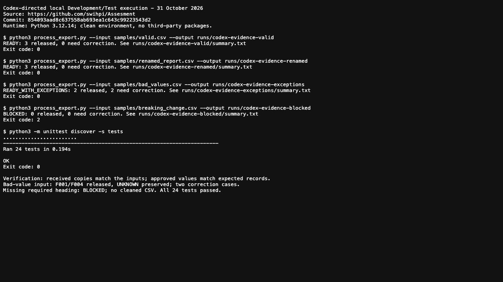
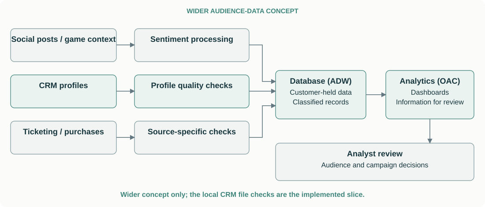

# From CRM exports to usable customer data

Stefan Willems — Senior Forward Deployed Engineer assessment

## The customer problem and the thinking behind it

A sports organisation wants to bring customer information from its CRM into an analytics environment. For the customer, a successfully delivered file is only part of the problem: they need to know which information they can use, what still needs attention, and whether correcting one problem will delay everything else. The available interface is a daily CSV export, but changing headings, incomplete values and conflicting records make that input difficult to trust. I built a small flow that preserves received data, releases valid records and reports correction cases; unreliable input prevents approval. The customer and incident are hypothetical, informed by my Oracle experience.

### Why a batch example?

For this exercise, I deliberately assumed a legacy CRM whose available interface is a scheduled CSV export. This keeps the demonstration focused on a practical source constraint and on making inconsistent data usable. Where the business needs customer changes reflected within seconds or minutes—and the source supports it—a streaming integration would be a stronger fit. The validation, identity and permission principles demonstrated here would still apply, while continuous processing would require additional handling for repeated updates, event ordering and recovery. The current implementation demonstrates batch processing only.

### Technology key

| Service | Abbreviation | Role in this proposal |
| --- | --- | --- |
| Oracle Integration Cloud | OIC | Retrieve files and coordinate processing. |
| Autonomous Data Warehouse | ADW | Store classified customer records. |
| Oracle Analytics Cloud | OAC | Present information through dashboards. |

### Key decisions

| Decision | Why |
| --- | --- |
| Use the existing CSV/SFTP export | No usable CRM API or supported application connector is available in the assumed environment. |
| Match confirmed headings by name | Labels and column positions can change without the underlying information changing. |
| Preserve uncertainty and reject conflicting identities | Missing information or conflicting records should not be resolved by guessing. |
| Release valid records; block unreliable input | Independent row errors should not block valid records; uncertain headings or broken structure prevent safe approval of the input. |
| Demonstrate the rules in standalone Python | Reviewers can reproduce the behavior without access to Oracle services. |

### The experience that informed the case

This assignment reminded me of a Social Media Sentiment Analysis initiative I championed through what we informally called the OCI Think Tank. It began with two people: Mark, an Oracle US sales representative, and me. We shared an enthusiasm for experimenting with customer solutions that could generate Oracle revenue while helping customers create their own commercial advantage and revenue opportunities. We then brought in like-minded colleagues from EMEA and the US, assembling the integration, analytics, product-management and database expertise needed to explore the use case. My contribution included architectural direction and evaluating which Oracle services could support the use case, including OIC, ADW and OAC. I understood OIC’s role in connecting systems and orchestrating data flows, but did not configure or implement integrations myself. I created several OAC dashboards; a colleague configured the database sentiment analysis.

The wider ambition was to combine aggregated social-media audience signals with other customer-held information, including individual profiles, ticket purchases, and merchandise transactions. This could help a company decide where to invest its advertising, promotion, and communication budget, and which audiences or customers to approach through email, push notifications, WhatsApp, or SMS. The intended outcome was more relevant engagement and increased revenue, while customers retained their source data in their own database. For this assessment, we make one foundational input dependable before it supports those decisions.

## The source and the missing handoff

The first discussion would establish what the CRM can reliably provide today, who owns the export and which constraints are genuine. A CSV interface may be adequate; replacing it is only useful if it solves a customer problem. For this hypothetical case, no usable CRM API or supported application-specific connector is available, including through OIC. The CRM does support scheduled CSV reports and delivery to customer-controlled SFTP. Each night at 02:00 UTC, it exports ID, name, region, joining date, last-purchase date and marketing permission; OIC retrieves the completed file.


The assumed incident is a report-template change: headings are renamed, columns are reordered, and some records contain missing or inconsistent values. The database itself need not have changed. We agree field meanings with the source owner and make those rules executable. Automated delivery alone does not establish that a renamed field has the intended meaning. The implemented demonstration starts with an available, completed CSV and ends with local output. The CRM export, SFTP collection, cloud integration, and database loading remain proposed deployment work.

For that deployment, we must also agree how completed files are recognised, how missing exports are reported, and how previously processed files are handled.

## The processing decisions

The local demonstration and proposed ADW deployment follow the same policy: preserve received data, release valid records and report correction cases. All six selected headings must exist. Customer ID, name, region and joining date require valid values; last-purchase date may be empty. Readable CSV mapping files define approved heading aliases and permission equivalents. We do not infer a field’s meaning from its spelling or invent missing identity.

| Situation | Processing decision |
| --- | --- |
| Approved renamed or reordered heading | Map by confirmed name; column position is not the contract. |
| Extra unused column | Report a warning and continue. |
| Missing/ambiguous required heading, malformed CSV or invalid encoding | BLOCKED: preserve received bytes and diagnostics; release no approved records. A valid-looking prefix is insufficient. |
| Missing ID, invalid required value or conflicting identity in a fully parsed file | Mark the affected records NEEDS_CORRECTION and release the other valid records. |
| Identical normalized duplicate | Retain one approved copy; report the duplicate as ignored. |
| Unknown permission | Preserve UNKNOWN, report a warning and retain the otherwise valid record. Campaign eligibility is separate. |


### What happens to 10,000 records with 800 failures?

Rejecting bad data is straightforward to describe. The harder question is what the customer loses while those problems are being corrected. For a fully parsed input with 800 independent required-value failures and no duplicates, received.csv retains all 10,000 records, cleaned.csv contains the 9,200 valid records, and correction/status reports identify the 800 exceptions. The run is READY_WITH_EXCEPTIONS . A test verifies this exact case. If a required heading is missing or the CSV structure breaks, the whole input is BLOCKED , because we cannot establish its meaning or completeness; no cleaned CSV is released. A readable input with no valid records is also BLOCKED.

This assumes the destination supports partial updates: missing rows must not be interpreted as deleted customers, and a partial selection must never blindly replace a complete customer table. The local program demonstrates the selection policy; ADW updates and later correction replay still need implementation. A missing-ID row remains traceable by its import batch and source-record reference, which identifies the received row rather than a real customer. No customer identity is manufactured to make the record pass.

### Permission is different from data quality

A reliably identified customer can still be ineligible for marketing. We preserve the source meaning: NO is an explicit opt-out, while UNKNOWN means missing or unrecognised information. For the assumed consent-based campaign, neither authorises sending. The single permission field is a demonstration simplification; production activation must check current permission for the relevant channel and purpose, a valid address or device identifier, and other agreed eligibility rules. Email permission does not automatically authorise push notifications, SMS or WhatsApp.

| Permission | Meaning | Assumed campaign treatment |
| --- | --- | --- |
| YES | Approved source value indicates permission for the specified channel and purpose. | Proceed to other eligibility checks; acceptance alone does not authorise sending. |
| NO | Explicit customer opt-out. | Exclude from the affected marketing action. |
| UNKNOWN | Permission missing or not reliably interpretable. | Exclude where confirmed permission is required; request clarification. |

The script normalizes these values but does not send messages or enforce campaign selection. An otherwise valid UNKNOWN record is marked `ACCEPTED_WITH_WARNING`. In production, approved access and campaign-specific filters must enforce restrictions; a flag that downstream exports can bypass is insufficient. Passing ingestion does not prove every source attribute is true or authorise a campaign.

### If the CRM renames the customer ID column

If `customer_id` becomes `customerdata_id`, the processor initially blocks release because the required ID heading has no approved mapping. The source owner confirms whether this is only a rename, with unchanged values, meaning and uniqueness. The integration owner can then add `customerdata_id → customer_id` to the mapping CSV, validate it in Development/Test and rerun the export. A test checks both outcomes. If identifier values or meaning have changed, a heading alias is insufficient: an approved identity relationship is needed.

## Demonstration and evidence

The Python processor is 176 lines, including comments and blank lines, and uses the standard library. It runs without cloud credentials, a database or additional packages. I direct Codex to execute the examples and tests, then review the results; the README contains exact setup and reproduction commands. Local files represent the raw-file archive, per-record status and approved selection, so the implementation demonstrates the policy illustrated in the cloud diagram.

### Python preview: checking real dates

This eight-line excerpt from the normalize function checks the joining and last-purchase dates. It requires the agreed YYYY-MM-DD format and a real calendar date, so a value such as 2024-02-30 is reported as INVALID_DATE. The complete processor also handles heading mappings, identity conflicts, record status and approved output.

process_export.py · lines 39–46[View full Python code on GitHub ↗](https://github.com/swihpi/Assesment/blob/main/process_export.py#L39-L46)

```python
    for field in ("member_since", "last_purchase_date"):
        if row[field]:
            try:
                if not re.fullmatch(r"\d{4}-\d{2}-\d{2}", row[field]):
                    raise ValueError("Expected YYYY-MM-DD")
                date.fromisoformat(row[field])
            except ValueError:
                problems.append((field, "INVALID_DATE"))
```

### How I execute and review the demonstration

I use Codex to run and verify the demonstration by providing the commands or describing the checks in natural language, then reviewing the reported outcomes against the expected results. In this run, the valid and renamed exports each released three records; the bad-value example released F001 and F004 and reported two correction cases; the missing required heading blocked release. All 24 tests passed. This approach lets me repeat the checks without manually entering each command in a terminal, while the README retains the commands for independent reproduction.



[Read the full execution log](evidence/codex-run-current.txt)

### One successful record

| Field | Received | Normalized |
| --- | --- | --- |
| Customer ID | F001 with surrounding spaces | F001 |
| Full Name | Alex, repeated spaces, Morgan | Alex Morgan |
| Home Region | NY with surrounding spaces | NY |
| Email Opt In | `y` with surrounding spaces | YES |
| Customer Since | `2022-04-15` | `2022-04-15` |

The dates retain their meaning. Another record has no last-purchase date and remains valid.

### One actionable failure

A record with joining date 2024-02-30 is excluded and reported with customer F003, the member_since field, INVALID_DATE and the corrective action. The same sample includes a missing customer ID and unknown permission. F001 and F004 remain valid and are released; F004 retains UNKNOWN with a warning. The other two records require correction. The outcome is READY_WITH_EXCEPTIONS, with the original bytes preserved and four source-record statuses available.

| Example | Recorded outcome |
| --- | --- |
| Valid export | READY: three normalized records. |
| Renamed/reordered report | READY: the same three expected records. |
| Bad-value export | READY_WITH_EXCEPTIONS: F001 and F004 released; two correction cases. |

The current reproduction results and test output are available in the [execution log](test-run.txt) and the public repository’s automated checks.

The program first preserves the received bytes as received.csv and leaves the original source unchanged. Each completed run writes record_status.csv, rejection and warning reports, a summary and a log. cleaned.csv contains approved records only. A READY or READY_WITH_EXCEPTIONS marker is written last; consumers must require one of those markers before using the output. BLOCKED or no completion marker means no approved release. Existing run folders cannot be overwritten.

### Correctness and operability

Twenty-four automated tests cover predefined output, heading changes, required fields, dates, NO versus UNKNOWN, duplicate handling, malformed input, encoding, reruns and failed report/completion-marker writes. They also verify received-byte preservation, the 10,000/800 case, an explicitly approved customerdata_id alias, and a structure error encountered after valid records. Original fixture values predated the original processor; the revised release expectations explicitly specify approved IDs and independent counts. The summary exposes parsing completeness, candidates, released records, warnings and duration. For fully parsed input:

Parsed records = Valid records + Rejected records + Identical duplicates removed

Malformed input is marked incomplete. No rows are released from an incomplete parse, even if some candidates looked valid; their status is NOT_RELEASED. If output writing fails before the final marker, the result must not be consumed. Batch and record references make diagnostics traceable, while a missing customer ID still prevents trusted customer linking.

### Performance and scaling

| Synthetic input | Verified output | Recorded wall time |
| --- | --- | --- |
| 1,000 records | 1,000 records | 0.039 seconds |
| 100,000 records | 100,000 records | 0.517 seconds |

These single local measurements include startup, received-file copying, processing and report writing. Input generation and independent output counting are outside the timer. They used Python 3.14.4 on macOS 26.6.2 ARM64 and do not establish Production or cloud capacity. Memory retained for identity comparisons and record statuses is the main scaling limit. We would measure peak memory and acceptable batch size before considering partitioning or database-backed checks, preserving duplicate detection across partitions.

## Production direction and boundaries

**Demonstration choice:** standalone Python makes the selected behavior locally reproducible. **Production recommendation:** first assess whether native OIC mappings and controls meet the validation, duplicate-handling, and diagnostic requirements; use a separate function where those requirements justify it. If custom Python is selected, OIC can invoke a separately hosted OCI Function. The rules could be reused, but a function handler, cloud input/output interface, and destination loading still require implementation. The command-line script is not an embedded Python library inside OIC.

### Retain received data; control approved use

In the proposed production design, OIC retrieves the completed SFTP export and preserves the original file in a restricted raw-file archive, with OCI Object Storage as the proposed location. OIC then coordinates validation and normalisation before invoking ADW loading. Native mappings and controls should first be assessed; the illustrated option invokes Python hosted separately in an OCI Function. For fully readable input, classified results are written to ADW with validation_status, validation_reason and import-batch/source-record references: valid records enter the approved selection, while correction cases remain restricted. Function interfaces, archive access, database loading and access enforcement still require implementation.

| Example | Proposed ADW status | Available use |
| --- | --- | --- |
| Required fields pass the checks | ACCEPTED | Available for downstream eligibility checks, not automatic campaign activation. |
| Customer ID missing, required date invalid, or identities conflict | NEEDS_CORRECTION | Retained for investigation; excluded from approved downstream use. |
| Required checks pass, permission is unknown | ACCEPTED_WITH_WARNING | Retained in the trusted dataset; excluded from campaigns requiring confirmed permission. |

The local files demonstrate the same order and selection policy: received.csv corresponds to the preserved raw file, record_status.csv records classification, cleaned.csv contains the approved selection, and rejected.csv supplies actionable correction diagnostics. For 10,000 fully parsed records with 800 independent failures and no duplicates, all 10,000 remain in the raw file; after validation, ADW can retain 9,200 approved records and 800 restricted correction cases. Exception storage must retain invalid values safely, such as an invalid date as source text. An unreadable file is archived and reported as a file-level failure; it is not represented as successfully parsed customer rows. ADW writes and correction replay remain proposed.

### Who corrects the data?

When an import has problems, the customer should know what remains usable, what is restricted, who is investigating and what happens next. In the proposed operating approach, the update would distinguish a source-data problem from a processing failure and establish an agreed point for the next update. The aim is to keep the customer informed while the responsible teams work through the issue, without promising a resolution time before the cause is understood.

The customer’s designated data owner is accountable for source quality; the integration team is accountable for applying the agreed rules and reporting failures. An exception CSV identifies the source file, affected row, available customer reference, problem and required action, and is delivered through an agreed secure channel to the responsible owner. The operating process is to assign the issue, correct the authoritative source, re-export, revalidate and reconcile the result. Unresolved counts and their age remain visible so the same records do not silently fail every day. Exception delivery, assignment and recovery tracking are proposed operating capabilities, not functions of the current script.

| Issue | Proposed responsible team |
| --- | --- |
| Missing ID or incorrect customer information | CRM/data owner, supported by the CRM administrator or data steward. |
| Missing or ambiguous permission | Owner of the authoritative consent records; UNKNOWN remains until reliable evidence resolves it. |
| Changed heading or incorrect mapping | Source owner confirms meaning; integration owner maintains and validates the approved mapping. |
| Transfer, processing or delivery failure | Integration engineering team. |

After a source correction, the updated export is validated again. A successful correction can move the affected row into the approved selection, with traceability and duplicate handling so reprocessing does not create extra customers. A permission value is not filled in merely to pass validation: if no authoritative evidence exists, it stays UNKNOWN and the relevant marketing restriction remains. Corrections should not silently overwrite newer customer information or more recent permission changes.


We never test a new script, mapping, or integration in Production first. Use synthetic files locally, then a dedicated Development/Test environment to validate completed-file detection, missing exports, permissions, connectivity, retries, raw-file retention, pre-load validation, classified ADW loads, partial updates, exception recovery and downstream exclusion. Only after review and successful validation should the flow be promoted to Production with separate configuration and monitoring. Only the local file-processing stage has been exercised here; no live customer dataset or Production system was used.

The current processor requires a completed source export and snapshots its received bytes before parsing. Live extraction, secure transfer, scheduling, ADW loading and status updates, exception delivery, exactly-once processing, sentiment scoring and campaign enforcement remain outside its implementation. Destination updates must support partial approval and reconciliation; a daily snapshot alone is insufficient for immediate permission changes, so marketing activation needs a suitable current-permission check.

If source failures recur, we review reporting, change ownership, supported interfaces, and operating cost. Stabilising the report may suffice. CRM modernisation or replacement becomes a separate recommendation where justified, weighed against migration cost and disruption.

## Codex assistance and my judgement

### How I approached this implementation

My strongest experience is in cloud architecture, analytics and bringing different technical disciplines together around a business problem. The original NHL sentiment proposition, internal advocacy, architectural direction and dashboard work came from my Oracle experience. For this assessment, I developed the hypothetical scenario with Codex, questioned assumptions and directed changes to the processing approach. Codex generated the Python implementation and executed the tests at my direction. I reviewed the functional outcomes and challenged whether the diagrams, code and operating explanation described the same solution. The examples below show where those questions changed the result.

### Questions that changed the design

| My review question | Decision and consequence |
| --- | --- |
| How does the CRM export actually reach the integration? | We made the scheduled CSV export, CRM-to-SFTP delivery and OIC retrieval explicit. |
| Why introduce unfamiliar database programming or a long script? | We chose a compact, independently runnable Python example I could inspect and discuss. |
| Why should 800 bad records prevent use of 9,200 valid ones? | We revised the policy to retain received data, release valid records and report correction cases. Unreliable input structure still blocks release. |
| Why do the production diagram and local demonstration describe different release rules? | I challenged the mismatch. The code, tests, diagrams and documentation were aligned around one processing policy, with local files representing the proposed ADW areas. |
| Who fixes missing data, and should missing permission mean NO? | We assigned source ownership and separated data-quality status from channel-specific marketing eligibility; missing permission remains UNKNOWN. |

These review questions shaped the requirements; the detailed implementation changes and their verification were AI-assisted. I also asked for a fresh GitHub-copy test on my Mac rather than relying on an assertion that the code would work. The updated solution is checked in clean Python environments and through automated repository tests. This gives evidence for the implemented behaviour while leaving cloud deployment and campaign controls explicitly unclaimed.

### How Codex helped and where judgement remains necessary

I chose Codex to work with documents, code and execution results in one workspace. It assisted with structure, tooling research, synthetic fixtures, expected outcomes, Python, tests, documentation and execution; a supplied Claude critique also informed the review. That assistance extended what I could deliver, but source meanings, operating responsibilities and the consequences of rejecting customer data still required judgement. The distinction between demonstrated behaviour and proposed cloud capabilities remains explicit.

The running processor has no LLM dependency. Known mappings, dates and duplicate handling need repeatable, explainable outcomes. AI could help investigate an unfamiliar field, but a person must confirm its meaning before approving a mapping. Neither AI nor the integration should invent missing identity or permission. Adding an agent to daily processing would need a specific customer benefit and a reliable way to validate its output.

## Wider context and historical examples

The broader idea combined different sources to support audience decisions:



Social post text is unstructured; derived sentiment scores and summaries are structured outputs. CRM, ticketing, and purchase records have their own definitions and checks. Aggregate sentiment may inform campaign timing. It does not identify a known customer’s sentiment. Combining individual records requires a reliable linking identifier and confirmation that the information may be used for that purpose.

### Original initiative

The initiative focused on NHL hockey. The original presentation includes Nashville Predators versus LA Kings. The initiative was internal and intended for exploration as an OCI Sports Unit pilot. It was discontinued because of other priorities within OCI OAC Product Management. Bringing engineers, product management, and DBAs together was a useful learning experience around an idea intended to increase OCI usage and help customers derive commercial value.

The NHL example used the OIC Twitter adapter to bring in Twitter activity, alongside game information obtained through the public NHL API. The data was brought together in ADW and presented through OAC dashboards, combining aggregate sentiment with match-day events.

### Original slide 6: aggregate sentiment

The original screenshot illustrates aggregate sentiment categories and trends. The source slide identifies Oracle Text in Autonomous.

*Historical screenshot is available in the private presentation; original images are not included in this repository.*

### Original slide 7: match-day context

The original screenshot places social information alongside game events. Correlating timelines is different from identifying an individual fan or establishing campaign impact.

*Historical screenshot is available in the private presentation; original images are not included in this repository.*

## Assignment coverage

| Assignment requirement | Evidence |
| --- | --- |
| Customer context, assumptions, and value | Sections 1–2 and the accompanying customer note. |
| Runnable ingestion and normalization | Processor, mappings, sample files, and README. |
| Schema drift, bad data, actionable errors | Sections 3–4 and executed examples. |
| Setup and run instructions | README prerequisites, commands, outputs, and exit statuses. |
| Architecture, trade-offs, and limitations | Sections 2–5. |
| Meaningful tests and reliability | Twenty-four passing tests, explicit expected output, and fresh-copy checks. |
| Logging and observability | Counts, parsing completeness, reports, log, duration, and completion markers. |
| Performance and scalability thinking | Recorded measurements, their limits, and the memory bottleneck. |
| AI disclosure and deliberate non-reliance | Section 6 and the README. |
